# Android 캡처

이번 Stage 단위 테스트의 native Robolectric 렌더. Figma native PNG 대조 점수는 원본 raster 부재로 산출하지 않았다.

## crew-bottom-toast

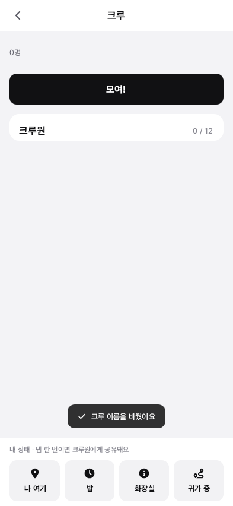

## festival-transfer-cobearers-light

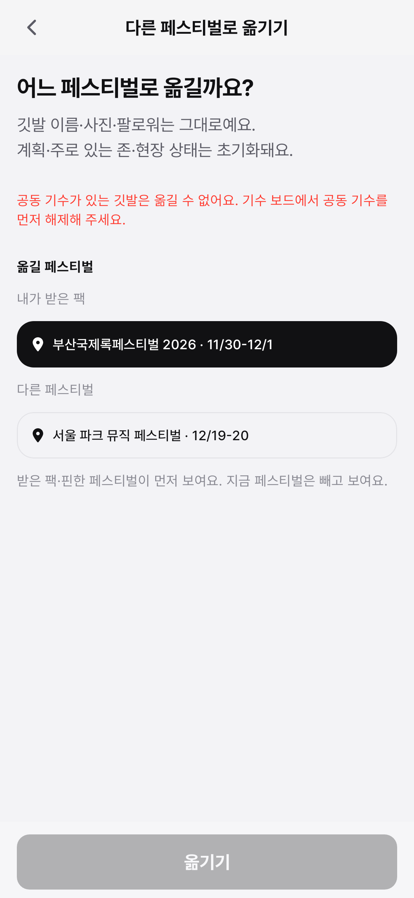

## festival-transfer-confirm-dark

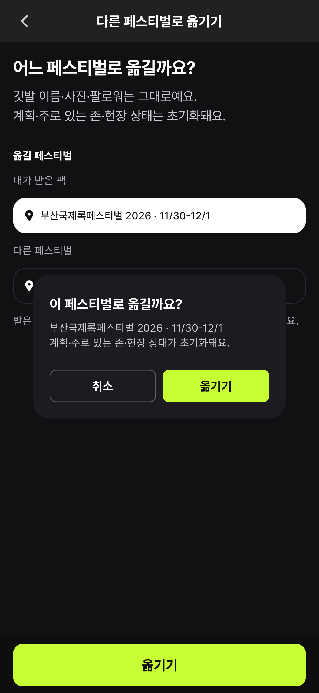

## festival-transfer-confirm-light

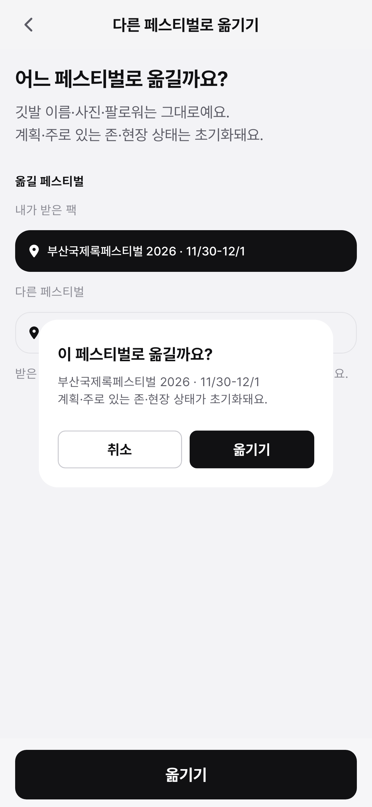

## festival-transfer-dark

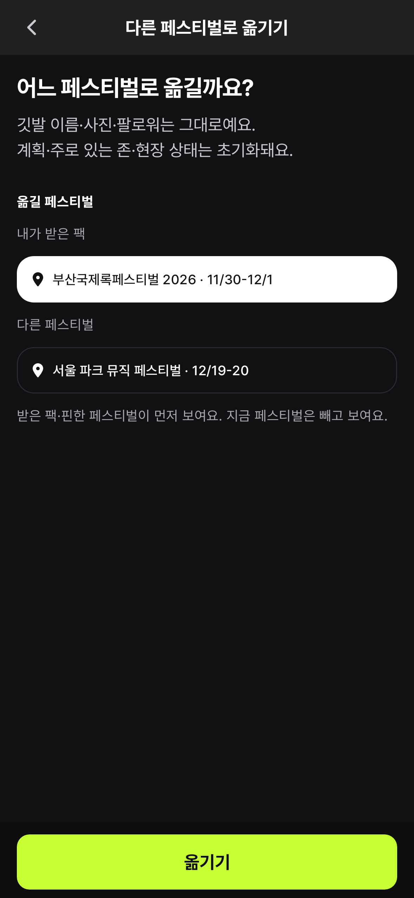

## festival-transfer-light

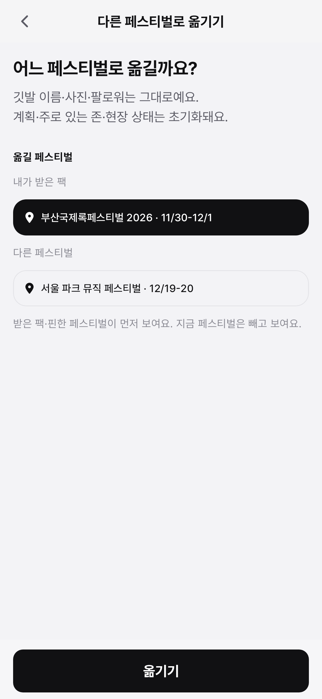

## flag-detail-menu-dark

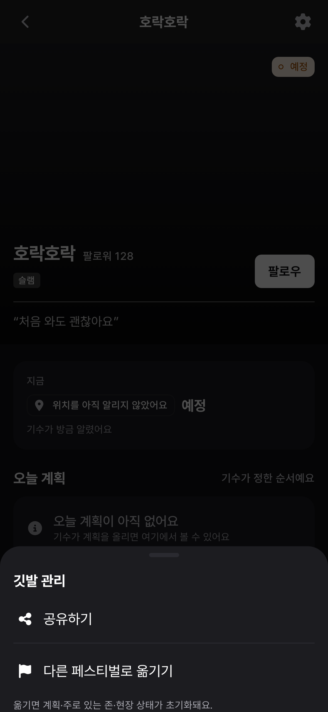

## flag-detail-menu-light

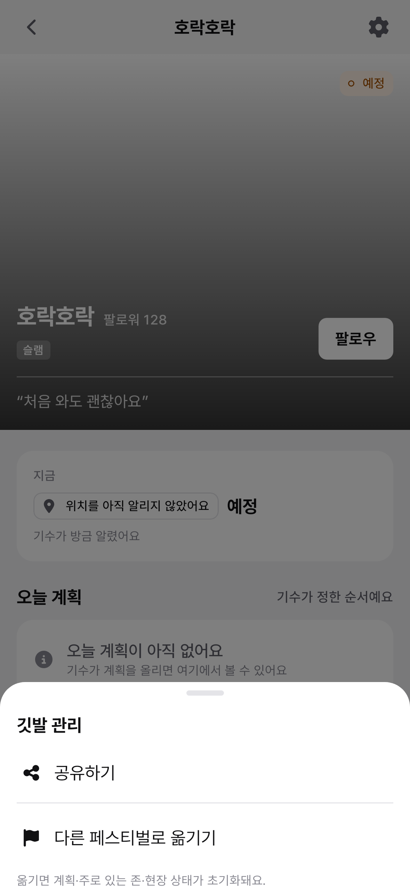

## s05-dark-offline-overlay

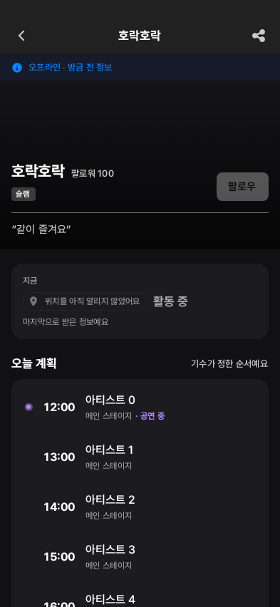

## s05-overlay-FlagDetailHeaderDesignParityTest-17

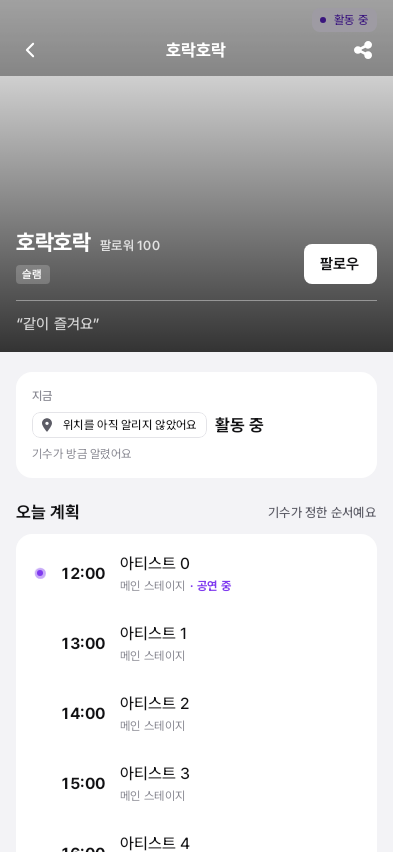

## s05-overlay-FlagDetailHeaderDesignParityTest-33

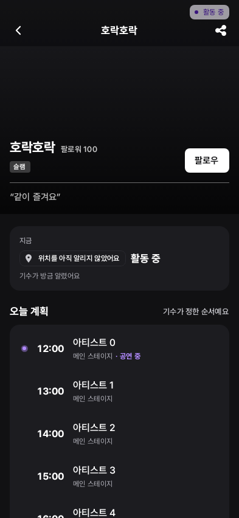

## s10-edit-dark

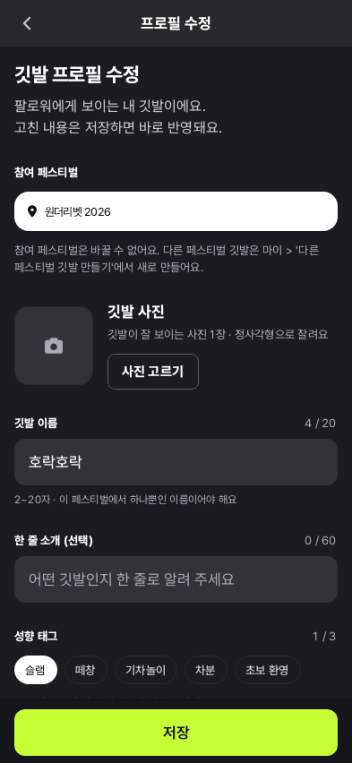

## s10-edit-light

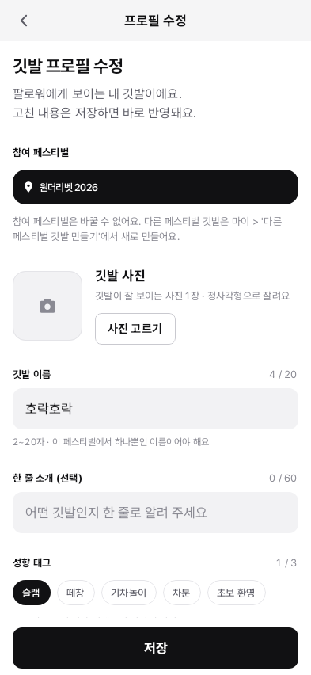

## s13-notifications-dark

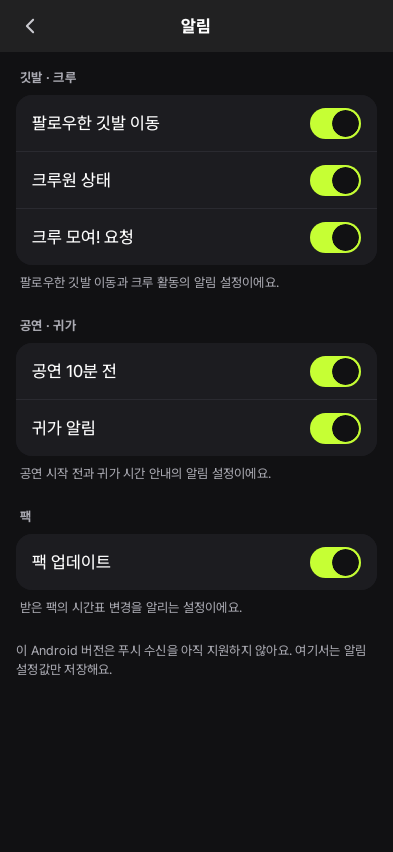

## s13-notifications-light

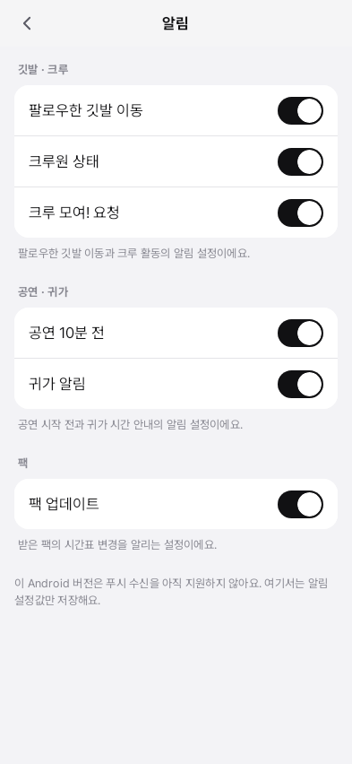

## s13-widget-installed

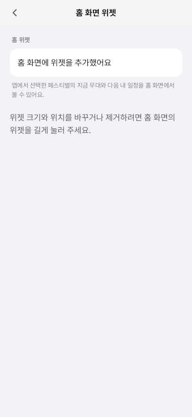

## s13-widget-supported

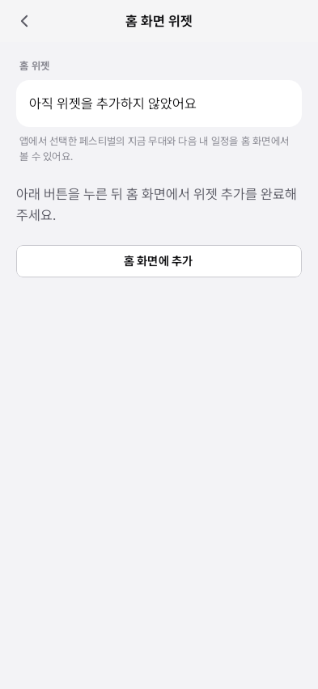

## s13-widget-unsupported

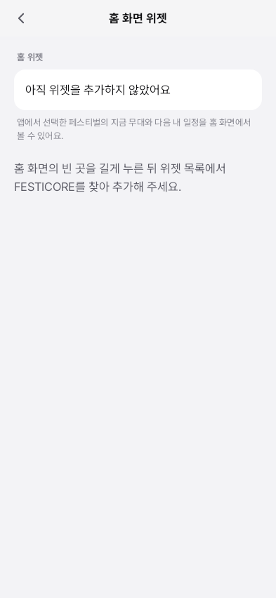

## s15-checklist-dark

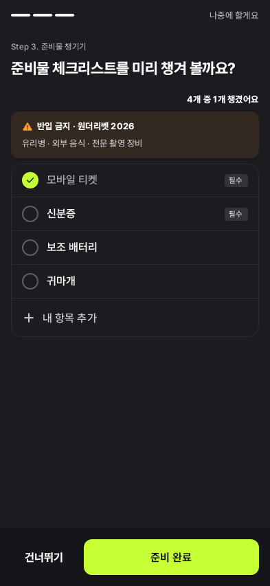

## s15-checklist-light

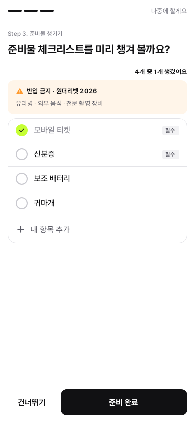

## s15-flags-dark

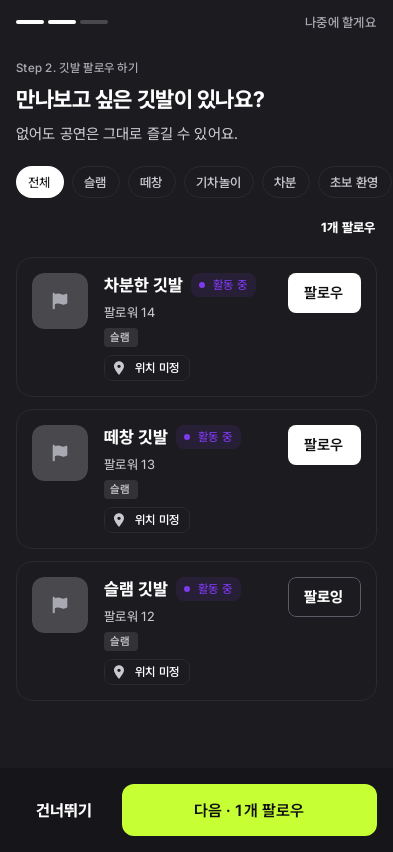

## s15-flags-light

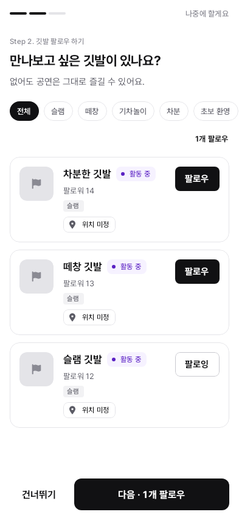

## s15-schedule-dark

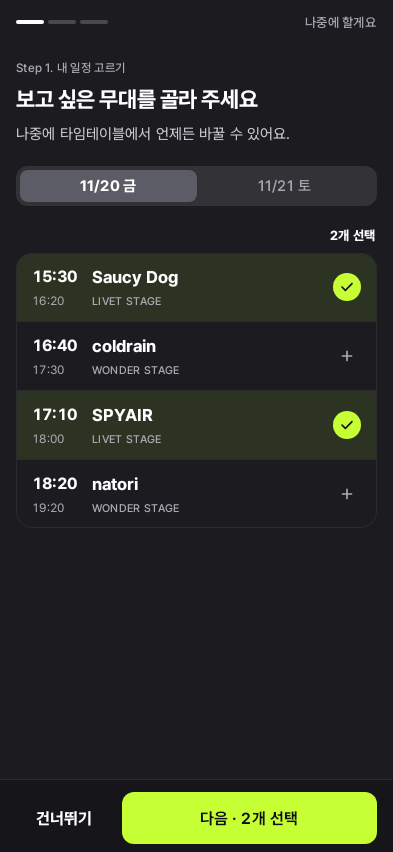

## s15-schedule-light

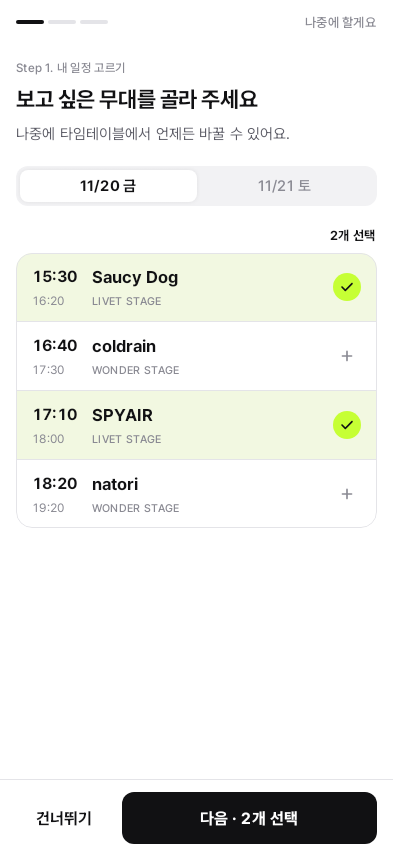
